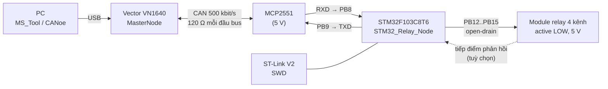
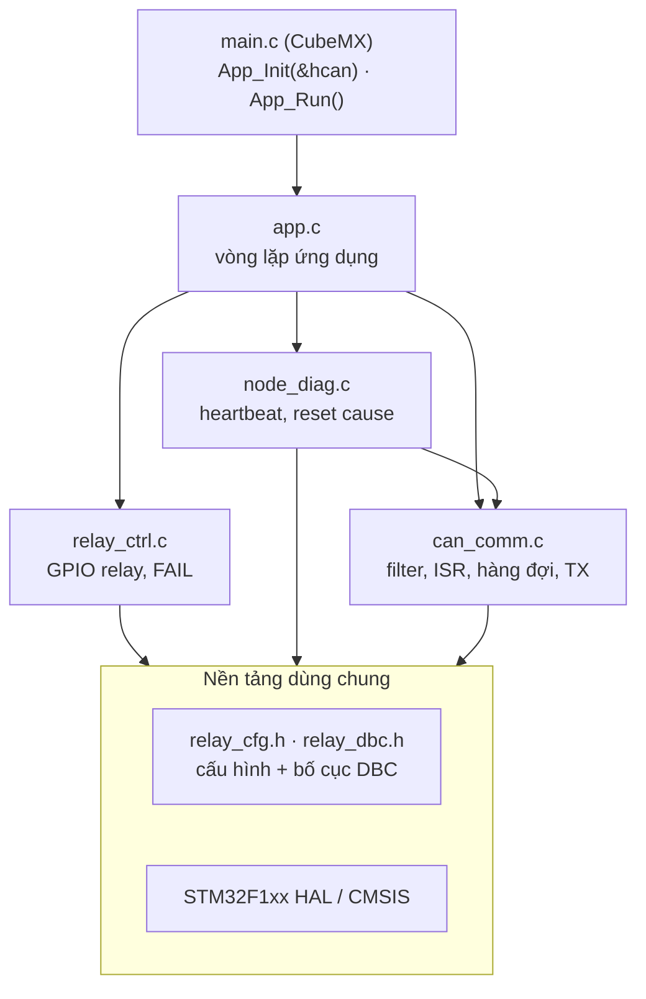

# STM32 Relay Node: điều khiển 4 relay qua CAN


Firmware cho node **`STM32_Relay_Node`** chạy trên Blue Pill (STM32F103C8T6). Node có ba nhiệm vụ:

- Nhận lệnh từ **MasterNode** qua CAN và điều khiển **4 relay**.
- Phản hồi trạng thái của từng relay.
- Phát **heartbeat** để Master biết node đang sống và đang chạy ở trạng thái nào.

Toàn bộ giao tiếp được mô tả trong file DBC [`STM32_Relay.dbc`](STM32_Relay.dbc). Firmware đã được kiểm thử trên bench với **Vector VN1640** và transceiver **MCP2551**.

---

## Mục lục

1. [Tính năng](#1-tính-năng)
2. [Kiến trúc hệ thống](#2-kiến-trúc-hệ-thống)
3. [Phần cứng](#3-phần-cứng)
4. [Giao tiếp CAN](#4-giao-tiếp-can)
5. [Kiến trúc phần mềm](#5-kiến-trúc-phần-mềm)
6. [Build](#6-build)
7. [Nạp và debug](#7-nạp-và-debug)
8. [Kiểm thử trên bench](#8-kiểm-thử-trên-bench)
9. [Xử lý sự cố](#9-xử-lý-sự-cố)
10. [Tuỳ chỉnh](#10-tuỳ-chỉnh)
11. [Hướng phát triển](#11-hướng-phát-triển)

---

## 1. Tính năng

- **Điều khiển 4 relay bằng 1 byte.** Mỗi relay chiếm 2 bit, nhận một trong 4 lệnh `NO_ACTION`, `ON`, `OFF`, `TOGGLE`. Master có thể điều khiển riêng một relay mà không ảnh hưởng ba relay còn lại.
- **Phản hồi trạng thái `0x101`.** Gửi theo chu kỳ **100 ms**, và **gửi ngay** khi có relay đổi trạng thái.
- **Heartbeat `0x102`.** Gửi mỗi **1 s** và một lần ngay khi khởi động. Nội dung gồm alive counter, uptime, **lý do reset**, số lệnh đã nhận, và bộ đếm lỗi TEC/REC.
- **Khởi động an toàn.** Relay luôn ở trạng thái OFF và **không "tách"** khi cấp nguồn hay reset, nhờ dùng output open-drain và ghi mức HIGH trước khi khởi tạo chân.
- **Phát hiện FAIL (tuỳ chọn).** Đọc tiếp điểm phản hồi; nếu trạng thái thật lệch với lệnh quá 100 ms thì báo `FAIL`.
- **Nhận frame không chặn chương trình.** Bộ lọc phần cứng chỉ cho `0x100` đi qua. Ngắt RX FIFO0 chỉ copy frame vào một hàng đợi lock-free, còn việc xử lý diễn ra trong vòng lặp chính.
- **LED chẩn đoán trên PC13.** Nháy chậm, nháy nhanh hay sáng đứng cho biết trạng thái bus mà không cần debugger.
- **Biến chẩn đoán `g_nodeDiag`.** Chỉ cần thêm một dòng vào Live Expressions để theo dõi toàn bộ.

---

## 2. Kiến trúc hệ thống



| Hướng | ID | Message | Chu kỳ |
|---|---|---|---|
| Master → STM32 | `0x100` | `MCU_Relay_Command` | do Master quyết định |
| STM32 → Master | `0x101` | `STM32_Relay_Status` | 100 ms, và ngay khi thay đổi |
| STM32 → Master | `0x102` | `STM32_Relay_Heartbeat` | 1000 ms, và ngay khi khởi động |

---

## 3. Phần cứng

### 3.1 Linh kiện

| Linh kiện | Ghi chú |
|---|---|
| Blue Pill STM32F103C8T6 | Thạch anh HSE 8 MHz, chạy 72 MHz |
| Module MCP2551 | **Cần nguồn 5 V** (4.5–5.5 V). Chân Rs nối GND |
| Module relay 4 kênh 5 V có opto | Loại kích mức **LOW**. Nếu có jumper H/L thì đặt ở L |
| ST-Link V2 | Bản clone dùng được qua **OpenOCD** (xem [mục 7](#7-nạp-và-debug)) |
| 2 điện trở 120 Ω | **Bắt buộc**, mỗi đầu bus một con (xem [3.5](#35-điện-trở-đầu-cuối)) |
| Vector VN1640 (hoặc PCAN) | Đóng vai MasterNode / công cụ test |

### 3.2 Sơ đồ chân

| Chân | Chức năng | Cấu hình CubeMX | User Label |
|---|---|---|---|
| PB8 | CAN_RX | CAN (remap) | – |
| PB9 | CAN_TX | CAN (remap), AF push-pull | – |
| PB12 | Relay 1 | Output **open-drain**, mức đầu **High** | `RELAY1` |
| PB13 | Relay 2 | Output **open-drain**, mức đầu **High** | `RELAY2` |
| PB14 | Relay 3 | Output **open-drain**, mức đầu **High** | `RELAY3` |
| PB15 | Relay 4 | Output **open-drain**, mức đầu **High** | `RELAY4` |
| PA0 | Feedback 1 | Input, **pull-up** | `FB1` |
| PA1 | Feedback 2 | Input, **pull-up** | `FB2` |
| PA2 | Feedback 3 | Input, **pull-up** | `FB3` |
| PA3 | Feedback 4 | Input, **pull-up** | `FB4` |
| PC13 | LED trạng thái | Output push-pull, mức đầu High, tốc độ Low | `LED_STATUS` |
| PA13 / PA14 | SWDIO / SWCLK | SYS → Debug: Serial Wire | – |
| PD0 / PD1 | OSC_IN / OSC_OUT | RCC → HSE: Crystal | – |

**Lý do chọn các chân như trên:**

- **Relay dùng open-drain trên PB12–PB15.** Module relay kéo chân IN lên 5 V. Khi STM32 "nhả" chân, IN lên đủ 5 V nên relay tắt dứt khoát. Các chân này thuộc loại **FT (chịu được 5 V)**.
- **PA0–PA3 _không_ chịu được 5 V.** Feedback ở đây chỉ được là tiếp điểm khô kéo xuống GND.
- **CAN đặt ở PB8/PB9 thay vì PA11/PA12.** Trên Blue Pill, PA11/PA12 nối vào cổng USB và có điện trở kéo lên ở D+. Ngoài ra, bốn chân PB8, PB9, 5V, G nằm liền nhau trên header nên đi dây rất gọn.

### 3.3 Nối dây

```
                 Blue Pill                         MCP2551
              ┌─────────────┐                   ┌──────────┐
              │ PB9 (CAN_TX)├──────────────────►│ TXD      │
              │ PB8 (CAN_RX)│◄──────────────────┤ RXD      │       CAN bus 500 kbit/s
              │             │                   │     CANH ├──┬─────────────┬── VN1640 pin 7
              │             │             5V ───┤ VCC      │ [120Ω]       [120Ω]
              │         GND ├──────────┬────────┤ GND      │  │             │
              │             │          │        │     CANL ├──┴─────────────┴── VN1640 pin 2
              │ PB12 ───────┼──► IN1   │        └──────────┘                    GND → pin 3
              │ PB13 ───────┼──► IN2   │        Module relay 4 kênh
              │ PB14 ───────┼──► IN3   │        VCC ← 5V, GND ← GND chung
              │ PB15 ───────┼──► IN4   │
              └─────────────┘     GND chung cho tất cả các khối
```

> ⚠️ Transceiver CAN **không bắt chéo** dây như UART: **TX của MCU nối vào TXD**, **RX của MCU nối vào RXD**.

### 3.4 Nguồn

| Tình huống | Cách cấp nguồn |
|---|---|
| Chỉ nạp code cho chip, chưa nối gì khác | Chân 3.3V của ST-Link → chân 3.3 của Blue Pill (nối đủ 4 dây SWD) |
| Chạy cả node (MCP2551 + relay) | **5 V** lấy từ micro-USB của Blue Pill, hoặc từ nguồn 5 V riêng. ST-Link **chỉ** nối SWDIO, SWCLK, GND |

Mỗi đường điện áp chỉ được có **một nguồn cấp**. **GND của mọi khối phải nối chung.**

### 3.5 Điện trở đầu cuối

Đo điện trở giữa **CANH và CANL khi tắt nguồn**. Kết quả phải là **khoảng 60 Ω**, tức hai điện trở 120 Ω mắc song song ở hai đầu bus.

**Tại sao lại bắt buộc?** Khi gửi bit recessive, transceiver "nhả" bus ra, và điện áp vi sai phải **tự xả về 0 V qua điện trở đầu cuối**. Nếu thiếu điện trở, bus xả rất chậm. bxCAN đọc lại bit mình vừa phát, thấy sai, và báo *bit error*. TEC tăng vọt, node chuyển sang error passive, và LED nháy nhanh.

> Ở chế độ Loopback, firmware vẫn có vẻ chạy bình thường dù thiếu điện trở, vì chip không đọc lại bus thật. Lỗi chỉ lộ ra khi chuyển sang chế độ Normal.

---

## 4. Giao tiếp CAN

Bus: CAN 2.0A (ID 11 bit), **500 kbit/s**. Tất cả signal đều theo **Intel (little-endian), không dấu**. Định nghĩa đầy đủ nằm trong [`STM32_Relay.dbc`](STM32_Relay.dbc).

### 4.1 `0x100` MCU_Relay_Command (Master → STM32, 1 byte)

```
Byte 0:   bit 7..6  | bit 5..4  | bit 3..2  | bit 1..0
          Relay_4   | Relay_3   | Relay_2   | Relay_1
```

| Giá trị | Lệnh | Tác dụng |
|---|---|---|
| 0 | `NO_ACTION` | Giữ nguyên trạng thái hiện tại |
| 1 | `ON` | Đóng relay |
| 2 | `OFF` | Mở relay |
| 3 | `TOGGLE` | Đảo trạng thái |

> Giá trị `NO_ACTION = 0` giúp Master điều khiển **một** relay mà không ghi đè ba relay còn lại.
>
> ⚠️ **Không gửi `TOGGLE` theo chu kỳ**: mỗi frame sẽ đảo relay một lần. Lệnh theo chu kỳ nên dùng `ON`/`OFF`.

### 4.2 `0x101` STM32_Relay_Status (STM32 → Master, 1 byte)

Bố cục byte giống `0x100`. Giá trị: `0` = OFF, `1` = ON, `2` = FAIL.

### 4.3 `0x102` STM32_Relay_Heartbeat (STM32 → Master, 8 byte)

| Byte | Bit | Signal | Ý nghĩa | Dấu hiệu bất thường |
|---|---|---|---|---|
| 0 | 0–7 | `HB_AliveCounter` | Tăng 1 mỗi frame, quay vòng 255 → 0 | **Đứng yên**: CPU hoặc vòng lặp chính đã chết |
| 1 | 0–3 | `HB_ResetCause` | 0 UNKNOWN · 1 POWER_ON · 2 PIN_RESET · 3 SOFTWARE · 4 IWDG · 5 WWDG · 6 LOW_POWER | Có giá trị IWDG/WWDG |
| 1 | 4 | `HB_RxOverflow` | 1 = đã có frame lệnh bị rơi | = 1 |
| 1 | 5 | `HB_FeedbackEnabled` | Firmware có bật FAIL detection hay không | – |
| 2–3 | 16 bit | `HB_UptimeSec` | Số giây kể từ lúc khởi động | **Tụt về số nhỏ**: node vừa bị reset |
| 4–5 | 16 bit | `HB_RxCmdCount` | Số frame `0x100` hợp lệ đã xử lý | Không tăng khi Master đang gửi |
| 6 | 0–7 | `HB_TEC` | Bộ đếm lỗi gửi | > 96 (warning), > 127 (passive) |
| 7 | 0–7 | `HB_REC` | Bộ đếm lỗi nhận | Như trên |

**Tại sao cần alive counter?** Khi CPU bị treo, mailbox TX của bxCAN vẫn có thể **tự gửi lại frame cũ**. Chỉ một giá trị **đang thay đổi** mới chứng minh CPU vừa chạy lại đoạn code đó.

### 4.4 Ví dụ

| Frame | Giải mã |
|---|---|
| `0x100 : 55` | Bật cả 4 relay |
| `0x100 : 12` | Relay 1 **OFF**, Relay 3 **ON**, Relay 2 và 4 giữ nguyên |
| `0x100 : C0` | Đảo Relay 4 |
| `0x101 : 41` | Relay 1 ON, Relay 4 ON, còn lại OFF |
| `0x102 : 32 03 35 00 00 00 00 00` | Alive = 50, reset do SOFTWARE, uptime 53 s, chưa nhận lệnh nào, TEC = REC = 0 |

---

## 5. Kiến trúc phần mềm

### 5.1 Cấu trúc thư mục

```
Relay_Ctrl_STM32/
├── README.md
├── STM32_Relay.dbc               ← DBC của mạng relay
├── Relay_Ctrl_STM32.ioc          ← cấu hình CubeMX
├── STM32F103C8TX_FLASH.ld
├── Relay_Ctrl_STM32 Debug.cfg    ← script OpenOCD (sinh tự động)
├── Relay_Ctrl_STM32 Debug.launch ← cấu hình debug CubeIDE
├── Core/
│   ├── Inc/
│   │   ├── app.h
│   │   ├── can_comm.h
│   │   ├── node_diag.h
│   │   ├── relay_cfg.h           ← CẤU HÌNH: chân, cực tính, chu kỳ
│   │   ├── relay_ctrl.h
│   │   ├── relay_dbc.h           ← ID, bit, giá trị theo DBC (nơi DUY NHẤT biết vị trí bit)
│   │   └── main.h, can.h, gpio.h, stm32f1xx_*.h   (CubeMX sinh)
│   ├── Src/
│   │   ├── app.c                 ← vòng lặp ứng dụng
│   │   ├── can_comm.c            ← filter, ngắt RX, hàng đợi, TX
│   │   ├── node_diag.c           ← heartbeat, lý do reset, g_nodeDiag
│   │   ├── relay_ctrl.c          ← driver relay, phát hiện FAIL
│   │   └── main.c, can.c, gpio.c, stm32f1xx_*.c, sys*.c   (CubeMX sinh)
│   └── Startup/
│       └── startup_stm32f103c8tx.s
└── Drivers/                      ← CMSIS + STM32F1xx HAL (CubeMX sinh)
```

### 5.2 Các tầng



| Tầng | Biết gì | Không biết gì |
|---|---|---|
| `relay_dbc.h` | Vị trí bit và giá trị của mọi signal | Phần cứng |
| `relay_cfg.h` | Chân nào, mức tích cực, chu kỳ gửi | Giao thức CAN |
| `relay_ctrl.c` | GPIO relay, feedback | CAN |
| `can_comm.c` | bxCAN, filter, hàng đợi | Ý nghĩa của frame |
| `app.c` | Ghép các tầng lại với nhau | Thanh ghi |

DBC thay đổi thì chỉ sửa `relay_dbc.h`. Đổi chân thì chỉ sửa trong CubeMX và `relay_cfg.h`.

### 5.3 Luồng dữ liệu

```
Bus ─► bxCAN filter (chỉ cho 0x100) ─► FIFO0 ─► ngắt USB_LP_CAN1_RX0
     ─► HAL_CAN_RxFifo0MsgPendingCallback(): CHỈ copy frame vào hàng đợi (8 frame)
     ─► App_Run() trong while(1):
          1. NodeDiag_OnLoop()            loopCount++
          2. CanComm_Receive() → giải mã → Relay_ApplyCommand()
          3. Relay_Task()                 giám sát feedback
          4. App_StatusTask()             0x101: mỗi 100 ms hoặc ngay khi đổi
          5. NodeDiag_Task()              0x102: mỗi 1000 ms
          6. App_LedTask()                LED theo trạng thái bus
```

Hàng đợi chỉ có **một bên ghi** (ISR ghi `head`) và **một bên đọc** (vòng lặp chính ghi `tail`), nên không cần tắt ngắt khi truy cập. `__DMB()` đảm bảo dữ liệu được ghi xong trước khi chỉ số `head` dịch chuyển.

### 5.4 Quy tắc khi sửa code

- Chỉ viết code **bên trong** các khối `/* USER CODE BEGIN … */ … /* USER CODE END … */` của file do CubeMX sinh ra. **Không** dán đè cả file.
- Toàn bộ code của mình trong `main.c` chỉ gồm 4 chỗ:
  ```c
  /* USER CODE BEGIN Includes */  #include "app.h"
  /* USER CODE BEGIN 2 */         App_Init(&hcan);
  /* USER CODE BEGIN 3 */         App_Run();                 // trong while(1)
  /* USER CODE BEGIN Error_Handler_Debug */
      __disable_irq();
      HAL_GPIO_WritePin(LED_STATUS_GPIO_Port, LED_STATUS_Pin, GPIO_PIN_RESET);
      while (1) { }
  ```

---

## 6. Build

### 6.1 Yêu cầu

- STM32CubeIDE **1.16** (có kèm STM32CubeMX và GNU Tools for STM32 12.3)
- Gói firmware **STM32Cube FW_F1 V1.8.7**

### 6.2 Mở project

1. Clone repo về máy.
2. Trong CubeIDE: `File → Import → General → Existing Projects into Workspace` → chọn thư mục repo → **Finish**.
3. Mở `Relay_Ctrl_STM32.ioc`, nếu CubeIDE hỏi migrate thì chọn **No**.

### 6.3 Các thông số CubeMX quan trọng

| Mục | Giá trị |
|---|---|
| SYS → Debug | **Serial Wire** |
| RCC → HSE | Crystal/Ceramic Resonator |
| Clock | HSE 8 MHz × 9 = **72 MHz**, APB1 **/2 = 36 MHz** (clock của CAN) |
| CAN | Prescaler **4**, BS1 **14 TQ**, BS2 **3 TQ**, SJW 1 → **500 kbit/s**, sample point 83.3 % |
| CAN | Operating Mode **Normal**, Auto Bus-Off **Enable**, Auto Retransmission **Enable** |
| CAN → NVIC | **USB low priority or CAN RX0 interrupts** |
| Project Manager → Code Generator | Pair .c/.h per peripheral ✓ · Keep User Code ✓ · Delete previously generated files ✓ |

### 6.4 Build

`Project → Clean` → `Ctrl+B`. Kết quả kỳ vọng: **0 errors, 0 warnings**. Ở cấu hình Debug (`-O0`): text khoảng **11.3 KB**, RAM khoảng **1.8 KB**.

---

## 7. Nạp và debug

### 7.1 Nối ST-Link

| ST-Link | Blue Pill | Ghi chú |
|---|---|---|
| SWDIO | DIO | |
| SWCLK | CLK | |
| GND | GND | |
| 3.3V | 3.3 | **Chỉ nối** khi board được nuôi bằng ST-Link |
| RST | – | **Không nối** với ST-Link clone |

Đặt **BOOT0 = 0** và **BOOT1 = 0**.

### 7.2 Debug Configuration

`Run → Debug Configurations… → STM32 C/C++ Application`

| Tab | Mục | Giá trị |
|---|---|---|
| Main | C/C++ Application | `Debug/Relay_Ctrl_STM32.elf` |
| Debugger | Debug probe | **ST-LINK (OpenOCD)** |
| Debugger → Show generator options | Reset Mode | **Software system reset** |
| | Frequency | **950 kHz** |
| | Debug in low power modes | **Enable** |
| | Stop watchdog counters when halt | **Enable** |

> Với ST-Link clone, debug probe *ST-LINK GDB server* sẽ đòi nâng cấp firmware dongle. OpenOCD không đòi hỏi điều đó.

### 7.3 Nạp và chạy

1. `F11` → **đợi**, không bấm Stop trong lúc đang nạp.
2. Nạp thành công khi cửa sổ **Debug** hiện `main() at main.c:… 0x0800xxxx (Suspended : Breakpoint)`.
3. `F8` để chạy. `Ctrl+F2` để kết thúc phiên debug; firmware vẫn nằm lại trong Flash.

### 7.4 Kiểm tra Flash

Mở Memory Browser tại `0x08000000`:
- Word đầu tiên phải là `20005000` (giá trị stack ban đầu).
- Word thứ hai phải là một số **lẻ** dạng `0800xxxx` (địa chỉ `Reset_Handler` + 1 cho bit Thumb).

Cách kiểm tra quan trọng nhất là **rút nguồn, cắm lại mà không có debugger**: firmware vẫn phải chạy, LED phải nháy.

### 7.5 Xoá trắng chip

Trong lúc đang debug, em click vào dòng `arm-none-eabi-gdb` ở cửa sổ Debug, rồi gõ:

```
monitor reset halt
monitor stm32f1x mass_erase 0
```

Sau đó **không** bấm F8. `Ctrl+F2` → `F11` để nạp lại.

### 7.6 Theo dõi trong debugger

Thêm `g_nodeDiag` vào **Live Expressions**. Với OpenOCD, giá trị có thể chỉ được cập nhật khi bấm **Suspend**.

| Trường | Ý nghĩa |
|---|---|
| `loopCount` / `uptimeMs` | CPU có còn chạy không |
| `txStatusCount` / `txHeartbeatCount` / `aliveCounter` | Frame có ra được bus không |
| `rxCmdCount` | Số lệnh `0x100` đã xử lý |
| `resetCause` | Lý do reset lần gần nhất (mã giống `HB_ResetCause`) |

Các biểu thức hữu ích khác, hiển thị dạng hex: `hcan.Instance->ESR`, `hcan.Instance->TSR`, `hcan.Instance->BTR`.

---

## 8. Kiểm thử trên bench

### 8.1 Trước khi cấp nguồn

- [ ] Điện trở CANH–CANL khoảng **60 Ω**
- [ ] Không có ngắn mạch giữa 5V và GND
- [ ] BOOT0 = 0
- [ ] Kênh của VN1640 / PCAN: **500 kbit/s**, chế độ **Normal** (không phải Silent)

### 8.2 LED PC13

| LED | Ý nghĩa |
|---|---|
| Nháy chậm (500 ms) | Bình thường, bus khoẻ |
| Nháy nhanh (100 ms) | CAN đang error passive hoặc bus-off: không ai ACK, thiếu điện trở, sai bitrate, hoặc MCP2551 không đủ 5 V |
| Sáng liên tục | Firmware đã rơi vào `Error_Handler()` |
| Tắt hẳn | Chip chưa chạy: kiểm tra BOOT0, thạch anh, nguồn |

### 8.3 Test relay

Gửi lần lượt từng frame `0x100`:

| Gửi | Relay (R4 R3 R2 R1) | `0x101` | `HB_RxCmdCount` |
|---|---|---|---|
| `01` | OFF OFF OFF ON | `01` | +1 |
| `55` | ON ON ON ON | `55` | +1 |
| `AA` | OFF OFF OFF OFF | `00` | +1 |
| `00` | Giữ nguyên | `00` | +1 |
| `C0` | R4 bật | `40` | +1 |
| `C0` | R4 tắt | `00` | +1 |

### 8.4 Heartbeat và lý do reset

| Thao tác | `HB_ResetCause` kỳ vọng |
|---|---|
| Bấm `F11` từ CubeIDE | `SOFTWARE` |
| Bấm nút RESET trên board | `PIN_RESET` |
| Rút nguồn rồi cắm lại | `POWER_ON` |

Sau mỗi lần reset, `HB_UptimeSec` phải đếm lại từ 0, và `HB_AliveCounter` phải tăng đều mỗi giây.

---

## 9. Xử lý sự cố

Các lỗi dưới đây đều đã gặp thực tế khi phát triển project này.

| Triệu chứng | Nguyên nhân | Cách xử lý |
|---|---|---|
| CubeIDE sinh thư mục `EWARM` với file `.ewp`/`.icf`, không build được | Toolchain/IDE đang chọn EWARM (IAR) | Project Manager → Toolchain/IDE = **STM32CubeIDE** |
| `multiple definition of 'hcan'` | Một `main.c` viết cho kiểu "tất cả trong main.c" đã chép đè lên project dùng `can.c` riêng | Chạy lại Generate Code. Chỉ sửa trong các khối USER CODE |
| `main.c` vẫn gọi `MX_TIMx_Init()` dù không dùng timer | `.ioc` được copy từ project khác | Tắt timer trong `.ioc`. Bật **Delete previously generated files** |
| `FB4_Pin undeclared`, hoặc `main.h` có macro lạ như `FB1A3_Pin` | Hai chân bị đặt trùng label | Đặt label PA3 = `FB4` |
| Relay 1 "tách" khi cấp nguồn | PB12 đang có mức khởi tạo Low | Đặt GPIO output level của PB12 = **High** |
| `ST-LINK firmware upgrade required` | ST-Link clone chạy firmware cũ | Dùng **ST-LINK (OpenOCD)** |
| `timed out while waiting for target halted` | Firmware cũ cản trở việc dừng CPU, hoặc tín hiệu SWD kém | Tháo dây RST → hạ tốc độ SWD → bật low-power và watchdog stop → *Connect under reset* kết hợp giữ nút RESET |
| `clearing lockup after double fault`, `pc: 0x20000108` | **BOOT0 = 1 và BOOT1 = 1**, chip khởi động từ SRAM | Đưa cả hai jumper về **0**, tắt nguồn rồi bật lại |
| `UNEXPECTED idcode: 0x2ba01477` | Chip trên board là hàng clone | Configuration Script User Defined → thêm `set CPUTAPID 0` |
| Live Expressions toàn 0 | OpenOCD chỉ cập nhật khi CPU dừng | Bấm **Suspend** để đọc lại |
| `txStatusCount = 2`, `txHeartbeatCount = 1`, rồi đứng yên | Cả 3 TX mailbox đã đầy vì không có ai ACK | Kiểm tra transceiver và node còn lại trên bus |
| Chạy bình thường cho tới khi Master gửi lệnh, sau đó chỉ còn error frame | CAN đang ở chế độ **Loopback**: STM32 không ACK frame của Master | Operating Mode = **Normal** (`BTR` phải là `0x002D0003`) |
| LED nháy nhanh, `ESR.LEC` = 4 hoặc 5 (bit error) | **Thiếu điện trở 120 Ω**, hoặc MCP2551 không đủ 5 V | Lắp 120 Ω ở cả hai đầu bus, đo VCC ≥ 4.75 V |

**Giải mã thanh ghi `ESR`:** bit 31..24 là REC · bit 23..16 là TEC · bit 6..4 là LEC (1 stuff, 2 form, **3 ACK**, **4/5 bit**, 6 CRC) · bit 2 BOFF · bit 1 EPVF · bit 0 EWGF.

---

## 10. Tuỳ chỉnh

Mọi thông số đều nằm trong `Core/Inc/relay_cfg.h`:

| Macro | Mặc định | Ý nghĩa |
|---|---|---|
| `RELAY_ACTIVE_LOW` | `1U` | Đổi thành `0U` nếu module kích mức HIGH. Khi đó CubeMX đặt output level = Low, mode = push-pull |
| `RELAY_FEEDBACK_ENABLE` | `0U` | Đổi thành `1U` để bật phát hiện FAIL qua PA0–PA3 |
| `RELAY_FB_ACTIVE_LOW` | `1U` | Chân feedback đọc LOW khi tiếp điểm đóng |
| `RELAY_FB_FAIL_TIME_MS` | `100U` | Thời gian lệch cho phép giữa lệnh và feedback trước khi báo FAIL |
| `STATUS_CYCLE_MS` | `100U` | Chu kỳ gửi `0x101` |
| `HEARTBEAT_CYCLE_MS` | `1000U` | Chu kỳ gửi `0x102`. Nhớ sửa `GenMsgCycleTime` trong DBC cho khớp |
| `CAN_RX_QUEUE_LEN` | `8U` | Kích thước hàng đợi RX (phải là luỹ thừa của 2) |

---

## 11. Hướng phát triển

- [ ] **Watchdog IWDG**, để `HB_ResetCause = IWDG` cho biết node đã tự cứu nó khỏi trạng thái treo
- [ ] **Huỷ frame cũ** đang kẹt trong mailbox (`HAL_CAN_AbortTxRequest`), để khi bus thông lại Master nhận ngay dữ liệu mới nhất
- [ ] **Timeout lệnh**: tự đưa relay về trạng thái an toàn khi Master im lặng quá lâu
- [ ] **Chẩn đoán UDS** (`0x22 ReadDataByIdentifier`): phiên bản phần mềm, số serial
- [ ] Bật **FAIL detection** với tiếp điểm phụ hoặc opto cách ly ở phía tải

---

**Tác giả:** Nguyễn Minh Sáng
